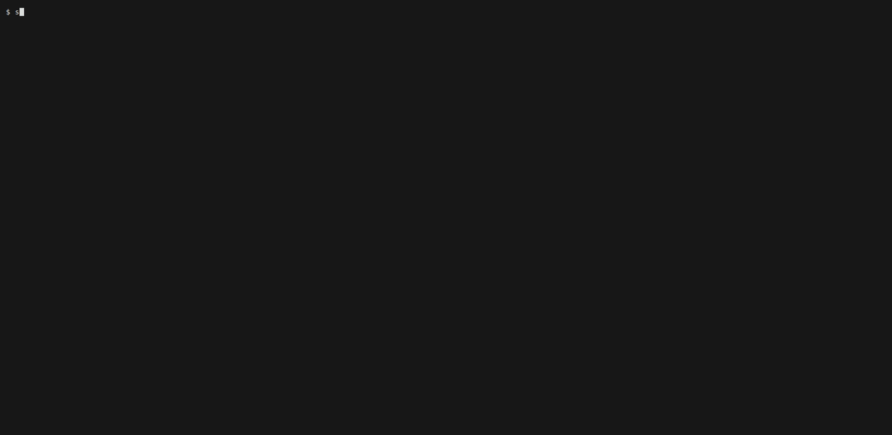

# seam

A side-by-side diff viewer for the terminal that knows your code. One key
switches between the changed hunks and the whole file, and resting the
mouse on a symbol shows its type and documentation from the language
server, on either side of the diff.



seam is not a pager like delta or diff-so-fancy, which colour the output of
`git diff`: it reads the repository itself, holds both versions of each
file, and lets you move through them.

## Features

- Side by side, or one column when the terminal is narrow
- The changed hunks or the whole file, one file at a time or all of them in
  one stream
- Hover and go-to-definition through the language server, on the new side
  and the old one, also when comparing commits
- Syntax colours for Go, Rust, JavaScript, TypeScript, JSX, TSX, HTML, PHP
  and Python, and any other language chroma knows, by configuration
- Changed words marked within a line
- A file list grouped by folder, and reload on change with `--watch`
- Keys, colours and servers configurable in one TOML file

## Requirements

- Linux
- git 2.36 or newer
- A terminal with mouse support for hover; without one, the caret does it
- For hover, the language server of the language, see
  [Language servers](docs/language-servers.md)
- To build: Go 1.27

## Install

```bash
go install github.com/dturcinovic/seam/cmd/seam@latest
```

Or from a clone, with [Task](https://taskfile.dev):

```bash
task build    # bin/seam
```

## Quick start

In a git repository with changes:

```bash
seam                # HEAD against the worktree
seam main           # main against the worktree
seam HEAD~1 HEAD    # the last commit
seam --staged       # what is staged
```

| Key | Does |
|---|---|
| `tab` / `shift+tab` | Next, previous file |
| `n` / `p` | Next, previous change |
| `f` | Hunks or the whole file |
| `u` | Side by side or one column |
| `s` | One file or all files in a stream |
| `b` | File list |
| mouse at rest | Hover |
| `ctrl` + click | Go to the definition, `ctrl+o` back |
| `i` | Caret: `K` hovers, `d` goes to the definition |
| `q` | Quit |

## Documentation

- [Usage](docs/usage.md): what seam compares, the views, the keys and the
  mouse
- [Language servers](docs/language-servers.md): which ones, how to install
  them, and their workspaces
- [Configuration](docs/configuration.md): `config.toml` with every key

## Contributing

See [CONTRIBUTING.md](CONTRIBUTING.md).

## License

[MIT](LICENSE)
